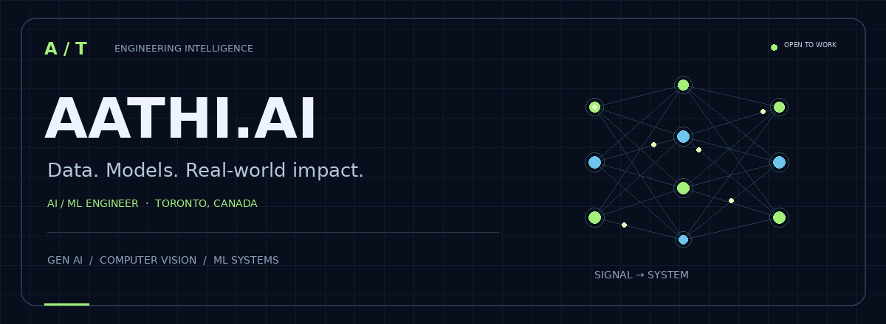
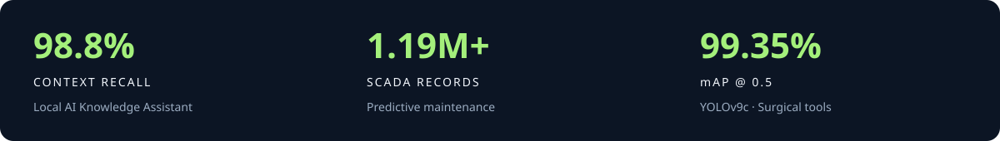

  

<h1 align="center">Aathi Abhishek Thiagarajan</h1>

<b>I build AI systems that connect good experiments with usable applications.</b>

  
  
  

  <a href="#about">01 / ABOUT</a> &nbsp; · &nbsp;
  <a href="#projects">02 / PROJECTS</a> &nbsp; · &nbsp;
  <a href="#tech-stack">03 / TOOLKIT</a> &nbsp; · &nbsp;
  <a href="#experience">04 / EXPERIENCE</a> &nbsp; · &nbsp;
  <a href="#connect">05 / CONNECT</a>

## A little context

I'm an **AI/ML Engineer in Toronto**, working across generative AI, computer vision, NLP, and time-series anomaly detection. I enjoy the full path: preparing data, comparing models, measuring trade-offs, and building an application people can use.

**My engineering interests:** local inference, grounded retrieval, reproducible evaluation, and deployment.

> Good AI work needs more than a model score. It needs a clear use case, honest evaluation, and an interface that makes the result useful.

## The project lab

**Seven projects. Different problems. A shared focus on building complete systems.**

[Generative AI](#rag) · [Computer vision](#vision) · [Speech & NLP](#speech)

### 🤖 Local AI Knowledge Assistant — Private, Offline RAG

A privacy-preserving assistant designed to run locally, without external API calls during inference.

**Measured results:** 98.8% context recall · 0.963 reranker MRR · 92.1% answer recall (v4).

<b>Explore the architecture, four experiments, and evaluation trade-offs ↗</b>

#### Model Architecture & Retrieval Pipeline

The Local AI Knowledge Assistant combines a quantized LLM with a two-stage hybrid retrieval pipeline to generate context-grounded responses with source attribution.

| Component | Implementation |
|---|---|
| **Model / Runtime** | Llama 3.1 8B Instruct (4-bit quantized), `llama.cpp` |
| **Semantic Retrieval** | Sentence Transformers + FAISS |
| **Keyword Retrieval** | BM25 |
| **Retrieval Fusion** | Reciprocal Rank Fusion (RRF) |
| **Reranking** | Cross-Encoder with calibrated relevance threshold |
| **Answer Grounding** | Retrieved context with source attribution |
| **Fallback Strategy** | Fixed fallback response when sufficient evidence is unavailable |

#### 🔬 Ablation Study & Prompt Optimization

Evaluated multiple retrieval configurations, relevance thresholds, and prompt strategies to improve answer recall while balancing response precision.

| Version | Retrieval / Prompt Configuration | Context Recall | Reranker MRR | Answer Recall | ROUGE-1 F1 |
|---|---|---|---|---|---|
| **v1 — Baseline** | Naive space-split BM25 + RRF (27-query seed set) | — | — | 69.4% | — |
| **v2 — Two-Stage RAG** | Word-boundary BM25 + Cross-Encoder (gate = -4.5) | 98.8% | 0.963 | 90.4% | 21.3% |
| **v3 — Strict Gate** | 1-sentence restriction + strict relevance (gate = -1.5) | 98.8% | 0.963 | 85.5% | **31.6%** |
| **v4 — Calibrated** | Intent-routing prompt + calibrated gate (gate = -5.0) | **98.8%** | **0.963** | **92.1%** | 25.3% |

#### 📊 Key Findings

- **Retrieval Quality:** Achieved 98.8% context recall and 0.963 MRR using hybrid retrieval and Cross-Encoder reranking.

- **Answer Recall:** Improved from 69.4% (baseline) to 92.1% (calibrated). The baseline used a 27-query seed set; cross-version comparisons depend on using the same evaluation protocol.

- **Strict Grounding Trade-off:** The stricter v3 configuration achieved the highest ROUGE-1 F1 (31.6%) but reduced answer recall to 85.5%.

- **Prompt Calibration:** Intent routing and calibrated relevance gating improved answer recall while preserving the retrieval-stage metrics.

#### 🏆 Selected Configuration

**v4 — Calibrated** was selected as the preferred configuration because it achieved the highest measured answer recall (92.1%) while maintaining strong retrieval performance.

The experiments demonstrate that retrieval optimization, relevance threshold calibration, and prompt design can materially affect RAG answer quality without changing the underlying LLM.

**Stack:** Python · Streamlit · Llama 3.1 · FAISS · BM25 · Sentence Transformers

---

### 🫁 COVID-19 CT Scan Classifier

A PyTorch image classifier for normal, COVID-19-positive, and non-informative chest CT slices.

- **19,685 images**; MobileNetV3-Large transfer learning.

- Reported **99.76% test accuracy**.

- Streamlit interface with file upload, camera input, per-class confidence scores, and light/dark modes.

- **Evaluation note:** the split was per image rather than per patient, so the reported accuracy may be optimistic.

---

### 👁️ Surgical Tool Detection — Computer Vision

Benchmarked YOLOv8n, YOLOv8m, and YOLOv9c on **3,000+ annotated images**.

| Best model | Precision | Recall | mAP@0.5 | mAP@0.5:0.95 |
|---|---:|---:|---:|---:|
| YOLOv9c | 97.69% | 97.86% | 99.35% | 89.24% |

Included COCO-to-YOLO conversion, image augmentation, and a Streamlit proof-of-concept for uploaded-video inference.

---

### 🗣️ LinguaFlow — Local Speech Translation

A local English ↔ French speech pipeline chaining **Whisper → MarianMT → Piper TTS**.

- No external API calls after the one-time model download.

- Voice and typed input, editable transcript, language swapping, and background text-to-speech.

- Evaluated on 500 WMT14 sentences: **39.1 / 35.4 BLEU** and **63.8 / 62.6 chrF** (EN→FR / FR→EN).

---

### 🧠 Tumor Detection Engine — Brain MRI Classification

Compared six architectures for four-class brain MRI classification using **5,712 training images** and **1,311 test images**.

- Tuned CNN hyperparameters with Keras Tuner.

- Fine-tuned MobileNetV2 achieved **94.2% accuracy**, 93% precision, 94% recall, and 93% F1.

---

### ⭐ Yelp Sentiment Analyzer

Benchmarked CNN, RNN, and BiLSTM models on **542K+ Yelp reviews**.

- Consistent preprocessing, tokenization, and sequence padding.

- Class-weighted training; 433K+ training and 108K+ test samples.

- Peak test accuracy: **87.58%**; F1-score: **0.728**.

- Streamlit inference with multi-class sentiment and model confidence.

---

### ⚡ Wind Turbine Intelligence — Predictive Maintenance

Benchmarked five transformer and graph-based anomaly-detection architectures across **1.19M+ SCADA records** and **84 operational features** during my Kinectrics co-op.

- Connected time-series analysis with LLM-assisted diagnostics.
- Delivered model outputs through REST APIs, Docker, and Streamlit.
- Focused on useful maintenance signals and end-to-end engineering.

**Industry work · Kinectrics · Sep–Dec 2025**

---

## The toolkit

### 🧠 Machine Learning & Deep Learning

### 🤖 GenAI, Retrieval & NLP

### 👁️ Computer Vision

### ⚙️ Engineering & Data

---

<b>How I approach an ML project ↗</b>

| Step | What I focus on |
|---|---|
| 01 · Define | The user problem, constraints, and success criteria |
| 02 · Prepare | Data quality, preprocessing, and appropriate splits |
| 03 · Benchmark | A useful baseline before more complex models |
| 04 · Evaluate | Task metrics, failure cases, and trade-offs |
| 05 · Deliver | APIs, an application interface, and deployment |

---

## 💼 Experience

### Kinectrics — AI/ML Engineer, Fall Co-op

📍 Toronto, ON · **Sep 2025 – Dec 2025**

- Predictive maintenance across 1.19M+ SCADA records and 84 operational features.

- Benchmarking of five anomaly-detection architectures.

- LLM diagnostics assistant and deployment through REST APIs, Docker, and Streamlit.

### Owujupe — Full Stack & iOS Developer, Fall Co-op

📍 Toronto, ON · **Sep 2024 – Dec 2024**

- Integrated third-party API data using Node.js and Express.js.

- Stored records in MongoDB before transitioning to PostgreSQL.

- Built paginated record tables and city-level data visualizations.

### Simsona Technology — System Administrator

📍 India · **May 2022 – Aug 2023**

- Maintained IT infrastructure and performed system troubleshooting.

- Supported MySQL database administration, deployment, and recovery.

---

## 🎓 Education

| Program | Institution | Period |
|---|---|---|
| Ontario Graduate Certificate — Applied AI Solutions Development | George Brown Polytechnic | Jan 2025 – Dec 2025 |
| Ontario Graduate Certificate — Mobile Application Development and Strategy | George Brown Polytechnic | Jan 2024 – Dec 2024 |
| B.E. — Computer Science and Engineering | Anna University, India | Aug 2018 – Jul 2022 |

---

## What I'm exploring next

**Production AI** · RAG evaluation · ML system design · Cloud deployment · CI/CD for ML

## Let's connect

**Open to AI / ML Engineer opportunities.** Based in Toronto, Canada.

[Portfolio ↗](https://aathiabhishek.github.io/aathi-portfolio/) &nbsp; · &nbsp; [LinkedIn ↗](https://www.linkedin.com/in/aathi-abhishek/) &nbsp; · &nbsp; [Email ↗](mailto:aathiabhishek2001@gmail.com) &nbsp; · &nbsp; [GitHub ↗](https://github.com/aathiabhishek)

<a href="#top">↑ Back to top</a>

